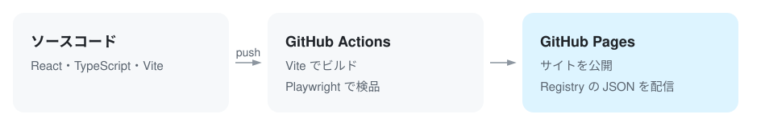

# Web 技術スタック

Flow Design を Web で実装するときの、標準の技術構成。

思想、設計原則、美的基準は、特定の技術に依存しない。Web では React を標準の実装とし、独自の shadcn Registry を構築する。React 以外のフレームワークに思想を適用してもよい。

<picture>
  <source media="(prefers-color-scheme: dark)" srcset="../diagrams/web-architecture-dark.svg">
  
</picture>

## 製品ごとに選べること

- **アプリケーションフレームワーク**：Next.js や Vite などから、製品の要件に応じて選ぶ。
- **ブランドカラーとフォント**：製品ごとに変更できる。Foundation が定める CSS 変数の値を、製品側で上書きする。
- **既存プロジェクトの技術**：Flow Design を適用するときは、技術の移行自体を目的にしない。Radix UI など、すでに使っている技術を維持してよい。

## 技術ごとの役割

各項目の「標準」は常に使う技術、「必要なときに使う」は要件がある場合だけ使う技術、「標準候補」は最初に検討する技術を表す。

### 言語と UI

**TypeScript**（標準）

- 役割：コンポーネントの props、Registry の設定、データの型を定義する。
- 理由：型の誤りをビルド時に検出できる。AI エージェントが生成したコードも、型チェックで検証できる。

**React**（標準）

- 役割：画面をコンポーネントの組み合わせとして記述する。
- 理由：shadcn/ui、Base UI、Motion、Recharts、TanStack Table が、いずれも React 向けのパッケージを提供している。

### 部品

**shadcn/ui**（標準）

- 役割：コンポーネントのソースコードを、製品のリポジトリにコピーして導入する。Registry の形式（`registry.json`）と、ビルド・導入用の CLI を提供する。
- 理由：導入したコードは製品側のコードになるため、製品の要件に合わせて変更できる。Flow Design の規則を反映したコンポーネントを、独自 Registry として同じ形式で配布できる。

**Base UI**（標準）

- 役割：ダイアログ、メニュー、ポップオーバーなどの動作、フォーカス管理、キーボード操作、WAI-ARIA 属性を提供する。スタイルは持たない。
- 理由：見た目を持たないため、Flow Design の美的基準を Tailwind CSS で自由に適用できる。原則 08 が求めるアクセシビリティを、部品の内部で担保できる。shadcn/ui は Base UI を公式にサポートしており、新しいプロジェクトの既定の部品ライブラリにしている。

### スタイル

**Tailwind CSS v4**（標準）

- 役割：ユーティリティクラスで余白、文字、色、角丸、状態ごとの見た目を指定する。
- 理由：v4 では設定を CSS の `@theme` に書き、テーマの値が CSS 変数として出力される。shadcn/ui は Tailwind CSS v4 に対応している。

**CSS Variables**（標準）

- 役割：色、文字、余白、角丸などのデザイントークンを保持する。ライトモードとダークモードの値を切り替える。
- 理由：製品ごとのブランドカラーとフォントを、コンポーネントのコードを変えずに変数の値だけで変更できる。shadcn/ui のテーマも CSS 変数（`--background`、`--primary` など）で定義されている。

### アイコン

**Lucide**（標準）

- 役割：アイコンを提供する。`lucide-react` の各アイコンは、SVG を描画する React コンポーネントである。
- 理由：shadcn/ui の設定（`components.json` の `iconLibrary`）で標準として使われるアイコンライブラリである。使ったアイコンだけがバンドルに含まれる。

### 動き

**CSS Animation / Transition**（標準）

- 役割：ホバー、開閉、表示の切り替えなど、状態の変化を伝える動きを実装する。
- 理由：追加のパッケージが不要で、`prefers-reduced-motion` に合わせて動きを減らせる。Tailwind CSS の `motion-safe:` と `motion-reduce:` で指定できる。

**Motion**（必要なときに使う）

- 役割：レイアウトの変化に追従する動き、要素が DOM から取り除かれるときの動き（`AnimatePresence`）、ドラッグなどのジェスチャーを実装する。
- 理由：これらの動きは CSS だけでは実装が複雑になる。`MotionConfig` に `reducedMotion="user"` を指定すると、OS の動きを減らす設定が有効なとき、位置と大きさの動きを無効にする。CSS で実装できる動きには使わない。

### グラフと表

**Recharts**（標準候補）

- 役割：折れ線、棒、円などのグラフを描画する。
- 理由：React のコンポーネントで SVG のグラフを組み立てられる。shadcn/ui の Chart コンポーネントは Recharts を使っている。

**TanStack Table**（標準候補）

- 役割：並べ替え、絞り込み、ページ送り、行の選択、列の表示切り替えなど、テーブルの状態と処理を管理する。
- 理由：マークアップとスタイルを持たないため、表の見た目を Flow Design の美的基準に合わせて実装できる。shadcn/ui の Data Table の手順は TanStack Table を使っている。

### 検品

**Playwright**（標準）

- 役割：実際のブラウザで画面を表示し、操作、スクリーンショット比較、アクセシビリティ検査を行う。
- 理由：ライトモードとダークモード（`colorScheme`）、動きを減らす設定（`reducedMotion`）を指定して表示を確認できる。設計ステップ 08「確認」を、自動で繰り返し実行できる。

## 技術どうしの関係

- shadcn/ui のコンポーネントは、動作とアクセシビリティを Base UI に任せ、見た目を Tailwind CSS のクラスで指定する。
- Tailwind CSS のクラスは、CSS 変数を参照する。ブランドカラーやダークモードの切り替えは、CSS 変数の値の変更で行う。
- グラフは Recharts、テーブルは TanStack Table を、Flow Design のスタイルを適用したコンポーネントとして Registry に含める。
- Playwright は、Registry のコンポーネントと、それを組み合わせた画面の両方を検品する。

## Registry

独自の shadcn Registry は、将来的に次の 4 層を提供する。

| | 層 | 内容 |
| --- | --- | --- |
| 1 | Foundation | テーマ、デザイントークン、共通スタイル |
| 2 | Components | ボタン、入力欄、ダイアログなど |
| 3 | Patterns | 検索付き一覧、設定フォーム、操作フローなど |
| 4 | Pages | ダッシュボード、顧客管理などの完成例 |

### Registry と AI スキルの分担

Registry は、品質を担保した実装を提供する。AI スキルは、目的、情報構造、配置、操作、言葉の選択などの設計判断を担う。

分ける理由は、同じコンポーネントでも、どこに何を置くべきかは画面の目的とユーザーによって変わるからである。Registry のコードは判断を含まない部品と完成例として保ち、判断は AI スキルが画面ごとに行う。

### 導入と更新

shadcn の CLI は、Registry の項目を JSON ファイルとして読み込み、コードを製品のリポジトリにコピーする。コピーしたコードは、Registry を更新しても自動では更新されない。

CLI には、導入前に差分を確認するオプション（`--diff`、`--dry-run`）と、既存のファイルを上書きするオプション（`--overwrite`）がある。項目ごとのバージョン指定の仕組みは、公式ドキュメントでは確認できなかった。Registry のバージョン管理と、製品への更新方針は、今後定める。

## 公式サイト

<picture>
  <source media="(prefers-color-scheme: dark)" srcset="../diagrams/web-site-dark.svg">
  
</picture>

想定する公開 URL は https://issei51.github.io/flow-design/ である。

公式サイトでは、次の内容を提供する予定である。

- 思想と設計規則
- コンポーネント
- 実際に操作できる UI
- Before / After の比較
- 完成画面
- 実装コード

Registry の項目は、`shadcn build` が書き出す静的な JSON ファイルとして、サイトと同じ GitHub Pages から配信する。製品側では、その JSON ファイルの URL か、`components.json` に登録した名前空間（例：`@flow-design/button`）を指定して導入する。

### 実装時に必要な設定

- Vite の `base` を `'/flow-design/'` にする。GitHub Pages のプロジェクトサイトは、リポジトリ名のパスの下で公開されるため。
- GitHub Pages の公開元を「GitHub Actions」にし、`actions/upload-pages-artifact` と `actions/deploy-pages` でデプロイする。
- GitHub Pages は、存在しないパスへのアクセスを `index.html` に転送しない。クライアント側のルーティングを使う場合は、ハッシュ形式の URL にするか、ページごとに HTML を書き出す。

Storybook は、必要になった段階で導入を検討する。

## 未定のこと

- デザイントークンの具体的な値
- Registry の項目名と、shadcn の item type（`registry:ui`、`registry:block` など）との対応
- Registry のバージョン管理と、製品への更新方針

## 参照した公式ドキュメント

2026 年 11 月に確認した。

- shadcn/ui：[Registry](https://ui.shadcn.com/docs/registry/getting-started)、[CLI](https://ui.shadcn.com/docs/cli)、[components.json](https://ui.shadcn.com/docs/components-json)、[Theming](https://ui.shadcn.com/docs/theming)、[Base UI を既定にした変更](https://ui.shadcn.com/docs/changelog/2026-07-base-ui-default)
- [Base UI](https://base-ui.com/react/overview/about)
- Tailwind CSS：[Theme variables](https://tailwindcss.com/docs/theme)、[Vite でのインストール](https://tailwindcss.com/docs/installation/using-vite)
- [Lucide React](https://lucide.dev/guide/packages/lucide-react)
- [Motion: Accessibility](https://motion.dev/docs/react-accessibility)
- [Recharts](https://github.com/recharts/recharts)
- [TanStack Table](https://tanstack.com/table/latest)
- Playwright：[Visual comparisons](https://playwright.dev/docs/test-snapshots)、[Emulation](https://playwright.dev/docs/emulation)、[Accessibility testing](https://playwright.dev/docs/accessibility-testing)
- [Vite: Deploying a Static Site](https://vite.dev/guide/static-deploy)
- GitHub Pages：[Using custom workflows](https://docs.github.com/en/pages/getting-started-with-github-pages/using-custom-workflows-with-github-pages)、[Creating a custom 404 page](https://docs.github.com/en/pages/getting-started-with-github-pages/creating-a-custom-404-page-for-your-github-pages-site)
